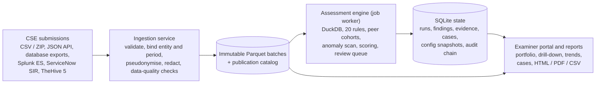

# SAT-SA: Solution Architecture

**Supervisory Analytics Tool for SOC Assessment** · Problem statement SIH26157 (NCIIPC) · Evaluation architecture document (2 pages). Full design: `docs/architecture.md`.

SAT-SA analyses the periodic alert and case-management submissions of Critical Sector Entities (CSEs) and shows NCIIPC examiners which entities, controls and alert samples need supervisory attention, and why. It supports the examiner's judgement; it does not replace it, and it gives indicators, not compliance verdicts.

## 1. Design principles

- **Supervisory, not operational.** SAT-SA works on periodic batch submissions. It does no real-time monitoring, collects no logs or telemetry, and is not a SIEM or SOC (PS §1).
- **Fully offline.** No Internet, cloud, SaaS or externally hosted AI. Every library is installed from a local wheelhouse and every web asset is served locally. The portals listen on loopback by default.
- **No AI or machine learning.** Findings come from SQL rules with named, configurable thresholds and robust statistics (median and MAD). Each one can be explained and reproduced, so the PS §5 AI/ML disclosures do not apply.
- **Evidence first.** Every finding cites the submitted records behind it. An entity whose data cannot support an assessment is marked *Insufficient Evidence*, never *Low concern*.
- **Reproducible and auditable.** Submitted data is never rewritten. Each run stores its configuration and a fingerprint of the data it read and can be replayed. Every action is appended to a hash-chained audit log.

## 2. Architecture

| Layer | What it does |
|---|---|
| **Ingestion** (`satsa.ingest`, Polars) | One service for every route in: web upload, JSON API, CLI, database exports, loopback REST. Product exports are translated by YAML mappings. Rows are bound to the submitting entity and period; a resent batch is idempotent. Analyst names are pseudonymised (HMAC-SHA256, local key), free text is redacted and unknown columns are dropped. Format errors hold an upload or reject an API batch. Supervisory signals (closed before created, missing references, numbering gaps) are kept as evidence. |
| **Storage** | Each submission is an immutable batch of Parquet files, published atomically through a catalog. A correction is a new version, never an overwrite. SQLite (WAL mode) holds runs, per-rule results, configuration snapshots, cases and identities, with numbered migrations that back up first. |
| **Job worker** | Imports and assessments run as durable jobs with leases, heartbeats and safe retries, after a memory and disk check, never inside a web request. |
| **Assessment engine** (`satsa.rules`, `satsa.scoring`) | Loads the assessment period into in-memory DuckDB, single-threaded so results are bit-for-bit repeatable. Runs 12 execution-gap rules (EG01–EG12) and 8 negative-space rules (NS01–NS08), plus a systemic detector for a shared SOC provider. Compares each entity with peers of its sector and size, using robust z-scores. Scores 8 capability domains, the 8 areas named in the PS, and combines them into an entity risk index. Builds a review queue of cited records plus random control samples. An exploratory scan of about 40 metrics flags unscored *leads*, i.e. previously unknown indicators. |
| **Presentation** (FastAPI, Jinja2, local ECharts) | SAT-SA portal (port 8001): portfolio ranking, entity profile, finding to evidence drill-down, trends across runs, review queue, cases, blind review. Admin portal (port 8000). Reports in HTML, PDF and CSV. |

## 3. How the problem statement is met

| PS need | SAT-SA mechanism |
|---|---|
| Entities requiring attention (Desc. i; F9) | Entity risk index and band, with evidence coverage per entity |
| Prioritise samples, controls, processes (Desc. ii; F10) | Review queue (cited records + random controls); controls ranked by entities failing them |
| Execution gaps, negative space (§3; F4–F6) | Rules EG01–EG12 (e.g. fast or uninvestigated closures, missing escalation, KPI gaming) and NS01–NS08 (e.g. silent critical assets, missing alert categories, absent night-time activity) |
| Anomalies, unknown indicators, peers (§3; F7–F8) | Peer cohorts with robust z-scores; anomaly scan of about 40 metrics (unscored leads) |
| Explainability and traceability (F11–F14) | Rationale and threshold per finding, cited evidence records, per-rule result for every entity, run fingerprint and replay |
| Reporting, trends, drill-down (F15–F17) | Portfolio and entity dashboards, trends across runs, finding to record drill-down, HTML/PDF/CSV reports |
| Validation against expert review (§8) | Blind review (scores hidden), pilot protocol with examiner labels and confidence intervals; field pilot pending real data |

## 4. Security and governance

- **Roles and separation of duties.** *Analysts* ingest, run assessments and tune rules; *examiners* review findings and decide cases. A case decision is signed off, and a rule change approved, by a second person. Administrators use a separate portal with offline TOTP multi-factor authentication. API clients use scoped, expiring service credentials.
- **Web protections.** Every state-changing request is CSRF-checked, every page has a content-security policy, and sessions expire.
- **Audit.** Ingests, runs, configuration changes and examiner actions are hash-chained (SHA3-256) and can be checked against Ed25519-signed checkpoints kept off the machine. The log is tamper-evident, not tamper-proof.
- **Controlled rule updates.** Rule packs are signed (HMAC-SHA256) and verified before import.

## 5. Deployment and sizing

- **Footprint.** One offline host, Python 3.11+, no database server. Three processes: the SAT-SA portal, the Admin portal and the job worker. Installed from a local wheelhouse or a container image. A production start has no accounts until a one-time setup; demo data exists only in a labelled demo mode. `satsa backup` / `satsa restore` move a deployment whole.
- **Measured** on one development laptop (4 cores, 23.7 GB RAM) with synthetic data: 5,000,000 alerts across 50 entities (21.4 million rows) were ingested and assessed in 162.6–164.2 s; 100,000 alerts are assessed in under 5 s. Memory needed: about 256 MiB plus 240 bytes per stored row. A supported tier above 100,000 alerts awaits measurement on the declared 4-vCPU / 8-GiB reference machine.
## 6. Data used and data minimisation (PS §2)

- **Input:** 15 canonical tables covering the PS §2 data:
  - alert metadata, cases, investigation workflow events, escalations, dispositions and closures, and the asset inventory;
  - plus detection rules, daily log-source volumes, remediation tickets, external incident reports, declared KPIs and SLA policies.
- **Not needed:** raw logs, packet captures and customer information. Log sources are submitted as daily event *counts* per asset and source, not log content.
- **Minimised at ingest:**
  - analyst, closer and case-owner names are replaced by keyed pseudonyms;
  - e-mail addresses, IP addresses, host names and long digit runs are masked in free text;
  - closure comments are kept only as a hash and hashed word triples, enough to detect copy-paste closures;
  - columns outside the canonical model are dropped.

## 7. Validation (PS §8)

- **Synthetic correctness check** (re-run on the current code, 2026-10-24, `satsa validate`). This shows the rules do what they specify; it is not real-world accuracy.
  - Defects and findings: 21 of 21 injected defects found, 0 false findings, 0 clean entities flagged.
  - Ranking: the 7 defect-bearing entities ranked first, and the ranking is unchanged under ±20% domain-weight changes (Spearman rho = 1.0).
  - Review queue: alerts in it are 5.2 times as likely to be defect-affected as randomly sampled alerts.
  - More sets (other seeds, decoys just under each threshold, an independently written generator): `docs/validation_summary.md`.
- **Comparison with expert manual review (field pilot).** SAT-SA runs on historical submissions that examiners have already reviewed (`satsa pilot`):
  - the protocol, thresholds and held-out entities are frozen before any label is seen;
  - examiners label findings blind, with no scores or bands, and a second examiner reviews the same entities independently; a third settles disagreements;
  - the evaluation reports precision, recall against examiner findings, review time per finding, agreement between examiners (Cohen's kappa) and 95% intervals.

  This is how "comparable to or better than manual sampling" is to be shown. It is not yet measured, and runs once authorised real data is available.

## 8. Status

- All results so far are on synthetic data.
- Connectors are verified on sample exports only.
- No production readiness is claimed before the field pilot and a measurement on the reference machine.
